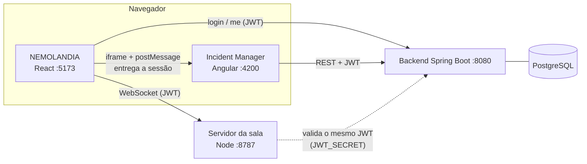

# NEMOLANDIA + Incident Management System

Dois projetos integrados em um repositório:

| Projeto | O que é | Stack |
|---|---|---|
| **`socialgame/`** — NEMOLANDIA | Sala isométrica **multiplayer** com chat em tempo real, skins de personagem, estúdio de beats e mural de graffiti | React 18, Vite, Tailwind, WebSocket (Node) |
| **`incident-management-system/`** | Gestão de incidentes com painel, estatísticas e comentários | Angular, Spring Boot 3 (JWT), PostgreSQL, Docker |

O jogo exige **login** (o mesmo do Incident Manager) e o **perfil da conta decide o papel**: `ROLE_ADMIN` = **root** (edita a sala, cria/edita incidentes); `ROLE_USER` = jogador (anda, conversa, troca de skin, consulta incidentes).

## Arquitetura



- **Uma conta só:** o login acontece no jogo; ao abrir o Incident Manager o jogo entrega a sessão ao Angular (sem pedir login de novo).
- **Confiança no servidor:** o servidor da sala valida a assinatura do JWT do backend; o nome e o papel vêm do token, nunca do cliente.

## Como rodar

Pré-requisitos: Docker, Node 20.19+ (ou 22+).

```bash
# 1) Backend + PostgreSQL + Incident Manager (http://localhost:4200)
cd incident-management-system
docker compose up --build

# 2) O jogo + servidor da sala (chat/multiplayer) -> http://localhost:5173
cd socialgame
npm install
cp .env.example .env      # Windows: copy .env.example .env
npm run dev
```

O `docker compose` também sobe o **servidor da sala** (porta 8787, com volume para salvar sala e chat); nesse caso o `npm run dev` detecta que ele já está rodando e usa o existente.

> **Chat universal em produção:** `ws://localhost:8787` só existe na sua máquina. Para qualquer visitante conversar, hospede o servidor da sala (a imagem `socialgame/Dockerfile.server`) em um endereço público com `wss://`, aponte `VITE_ROOM_WS_URL` para ele antes do `npm run build` e inclua o endereço do jogo em `ROOM_ALLOWED_ORIGINS`.

### Contas de demonstração (criadas automaticamente)

| Perfil | E-mail | Senha |
|---|---|---|
| Administrador (**root**) | `usuario@usuario.com` | `12345678` |
| Leitor (jogador) | `leitor@user.com` | `12345678` |

Qualquer pessoa também pode **criar conta** na tela de login (entra como jogador). Em produção, use `SEED_DEMO_USERS=false`.

Para ver o multiplayer, entre com contas diferentes em duas abas (uma anônima) ou em dois navegadores.

## Variáveis importantes

| Onde | Variável | Para quê |
|---|---|---|
| Backend / servidor da sala | `JWT_SECRET` / `ROOM_JWT_SECRET` | **Precisam ser iguais.** Troque o padrão de desenvolvimento em produção |
| Backend | `CORS_ALLOWED_ORIGINS` | Origens do jogo e do Angular autorizadas a chamar a API |
| Backend | `SEED_DEMO_USERS` | `false` em produção |
| Jogo | `VITE_API_URL`, `VITE_ANGULAR_URL`, `VITE_ROOM_WS_URL`, `VITE_TALKTOME_WIDGET_KEY` | Endereços dos serviços (veja `socialgame/.env.example`) |
| Angular | `src/app/core/config/app-config.ts` | URL da API e origens do jogo autorizadas a embuti-lo |

## Testes

```bash
cd socialgame && npm test                 # pathfinding, skins, sessão e servidor da sala (WebSocket)
cd incident-management-system/frontend && npm test
```

## Problemas comuns

- **Login do jogo diz "Não foi possível conectar ao servidor":** o backend não está no ar (`docker compose up`) ou `VITE_API_URL` está errado.
- **"A sala recusou sua sessão":** `ROOM_JWT_SECRET` do servidor da sala diferente do `JWT_SECRET` do backend.
- **Incident Manager em branco dentro do jogo:** o Angular não está em `http://localhost:4200` ou o endereço do jogo não está em `gameOrigins` (Angular) / `CORS_ALLOWED_ORIGINS` (backend).
- **O chat só mostra minhas mensagens:** o servidor da sala não está acessível (o chat mostra "desconectado" e um botão Reconectar) ou as duas contas estão no mesmo navegador (use outro navegador/janela anônima).
- **Mudei o `.env` e nada mudou:** reinicie `npm run dev` / `npm run server`.

Detalhes de cada projeto: [`socialgame/README.md`](socialgame/README.md) · [`incident-management-system/README.md`](incident-management-system/README.md).
